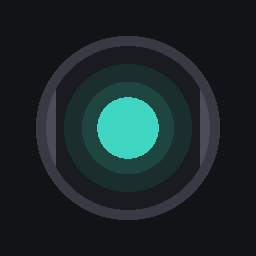
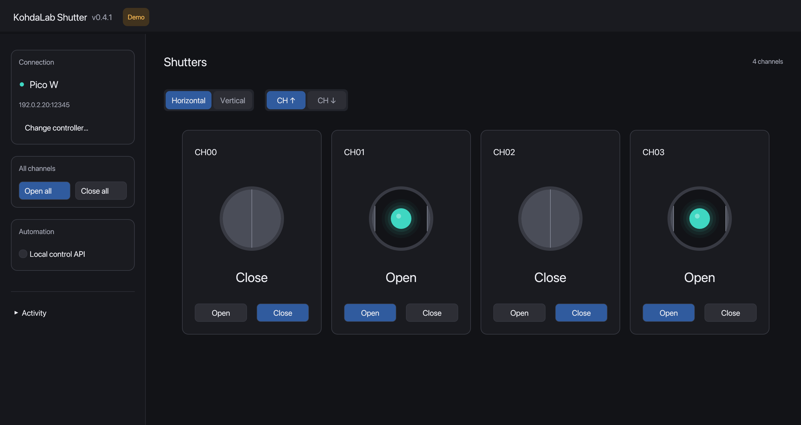
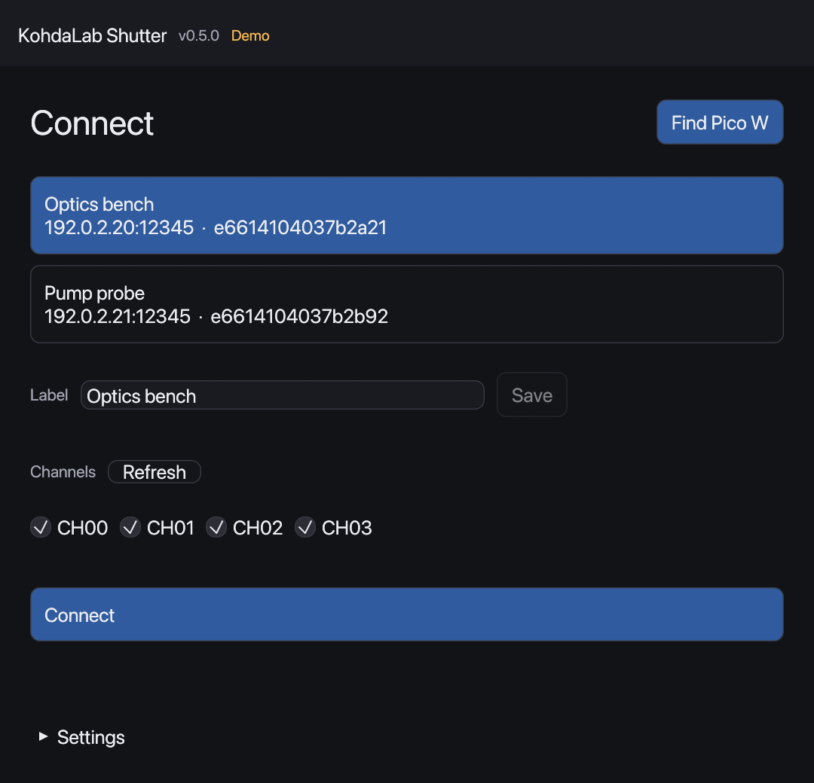
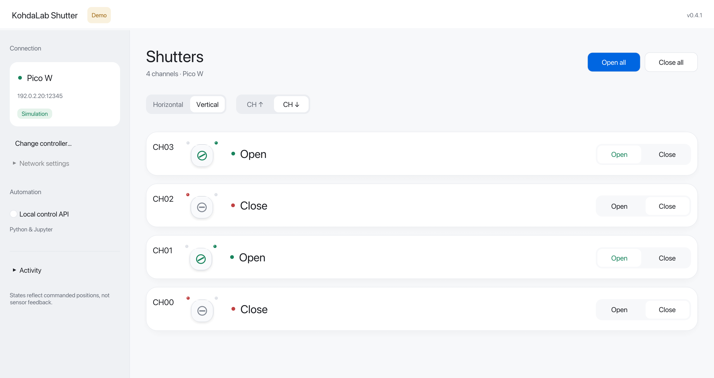
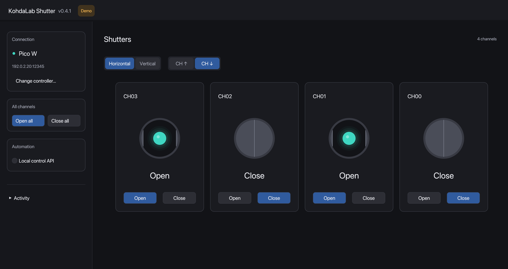
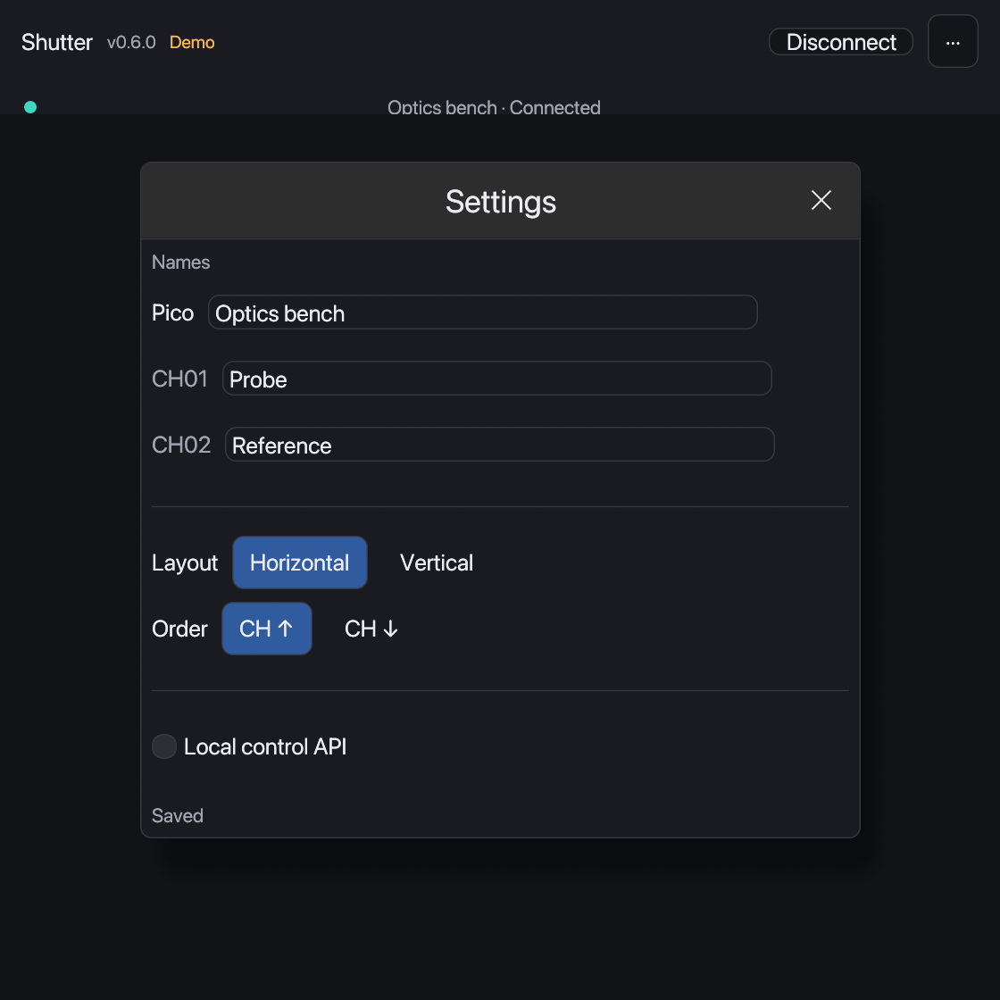

# KohdaLab Shutter

[](https://github.com/woolen-yarn/kohdalab-shutter/actions/workflows/test.yml)
[](LICENSE)

KohdaLab Shutter opens and closes servo-driven optical shutters from a lab computer. Use it to select a networked Pico W controller, reserve the channels for your experiment and operate each shutter from a compact desktop window.

KohdaLab Shutterは、実験室のPCからサーボ式の光シャッターを開閉するアプリです。ネットワーク上のPico Wを選び、実験で使うチャンネルを確保して、操作画面から個別に開閉します。

[Documentation / ドキュメント](docs/README.md) · [Report an issue / 問題を報告](https://github.com/woolen-yarn/kohdalab-shutter/issues)

## Downloads / ダウンロード

**KohdaLab Shutter 1.0.1**

| Platform / OS | Install / インストール版 | Portable / ポータブル版 | Hardware validation / 実機検証 |
| --- | --- | --- | --- |
| Windows 10/11 (x64) | [Setup (.exe)](https://github.com/woolen-yarn/kohdalab-shutter/releases/download/v1.0.1/kohdalab-shutter-1.0.1-windows-x64-Setup.exe) | [ZIP](https://github.com/woolen-yarn/kohdalab-shutter/releases/download/v1.0.1/kohdalab-shutter-1.0.1-windows-x64.zip) | Simulated Pico / 模擬 Pico で検証 |
| macOS 13+ (Apple Silicon / Intel) | [DMG](https://github.com/woolen-yarn/kohdalab-shutter/releases/download/v1.0.1/kohdalab-shutter-1.0.1-macos-universal.dmg) | [ZIP](https://github.com/woolen-yarn/kohdalab-shutter/releases/download/v1.0.1/kohdalab-shutter-1.0.1-macos-universal.zip) | Physical-device operation unverified / 実機操作未検証 |
| Ubuntu 24.04 (x86_64) | [DEB](https://github.com/woolen-yarn/kohdalab-shutter/releases/download/v1.0.1/kohdalab-shutter_1.0.1_amd64.deb) | [tar.gz](https://github.com/woolen-yarn/kohdalab-shutter/releases/download/v1.0.1/kohdalab-shutter-1.0.1-linux-x86_64.tar.gz) | Physical-device operation unverified / 実機操作未検証 |

Use Setup on Windows, drag the app from the DMG to Applications on macOS, or install the DEB on Ubuntu. For portable use, extract the archive before launching. / Windows は Setup、macOS は DMG からアプリを Applications へコピー、Ubuntu は DEB を使います。ポータブル版は展開して起動します。

Windows packages are unsigned. macOS packages are ad hoc signed and not notarized. / Windows 版は未署名、macOS 版はアドホック署名で未公証です。 [Installation guide / 導入手順](docs/install.md)

[Release notes / リリースノート](https://github.com/woolen-yarn/kohdalab-shutter/releases/tag/v1.0.1) · [SHA-256](https://github.com/woolen-yarn/kohdalab-shutter/releases/download/v1.0.1/SHA256SUMS.txt) · [Linux SHA-256](https://github.com/woolen-yarn/kohdalab-shutter/releases/download/v1.0.1/SHA256SUMS-linux.txt) · [Source ZIP / ソース](https://github.com/woolen-yarn/kohdalab-shutter/releases/download/v1.0.1/kohdalab-shutter-1.0.1-source.zip)

## Pico server / Pico 側の準備

The MicroPython firmware in [`server/`](server/) runs on the Pico W or Pico 2 W. It controls the PCA9685 servo driver, handles local buttons and manages channel ownership. The desktop connects to it over the lab network.

[`server/`](server/) の MicroPython ファームウェアは Pico W または Pico 2 W で動作し、PCA9685、物理ボタン、チャンネルの確保を管理します。PC アプリは研究室のネットワーク経由で接続します。

For initial setup or an update, use the USB uploader in the release source ZIP. / 初回書き込み・更新は配布ソース ZIP に含まれる USB 転送ツールを使います。 [Pico setup guide / Pico の準備と更新](docs/pico-upload.md)



*Control window with simulated hardware. / 模擬機器を使った操作画面。*

## Quick start / クイックスタート

1. Start the Pico W controller on the lab network. / 実験室ネットワーク上のPico Wを起動します。
2. Open Shutter, choose **Find Pico W**, select the controller and channels, then choose **Connect**. / **Find Pico W** で制御器を探し、使用するCHを選んで **Connect** を押します。
3. Click a channel’s aperture to toggle it. The display shows the commanded position. / 各CHの光窓をクリックして開閉します。画面は指令した位置を表示します。

## Interface / 画面

Click a channel name and press Enter to save it on this PC. The connection menu releases channels, and **··· → Settings** opens layout, display order and local API settings. / CH 名は Enter で確定し、この PC に保存します。接続名メニューでチャンネルを解放し、**··· → Settings** で配置・表示順・外部 API を設定します。

<details>
<summary>Connection picker and layouts / 接続画面とレイアウト</summary>







</details>

## Automatic settings / 設定の自動保存

The Pico name is shared and retained on the Pico in `device_config.json`. After a short typing pause, a valid change saves automatically; Settings shows Saving / Saved or an error without disconnecting the shutters. Calibration and Wi-Fi are kept separately.

Channel names edited in the GUI are display names for this PC only. They are stored per Pico device ID and CH number in the PC settings and are never written to the Pico, so other Picos and other PCs are unaffected. A CH without a PC name shows the shared name reported by the Pico (or `CH00`…). Entering the Pico's name again returns that CH to the shared name. Settings from earlier versions keep working and start with no PC names.

PC layout, order, selected channels, CH display names, endpoint/broadcast and Local control API opt-in are retained in `~/.kohdalab/shutter/config/config.json` (Windows: `%USERPROFILE%\.kohdalab\shutter\config\config.json`). On the first normal launch, a safe default file is created automatically when absent. Existing valid, corrupt or foreign files are never overwritten; loading does not acquire channels or move shutters. Authentication tokens are regenerated, not saved. Startup remembers the last device/available CHs but does not acquire channels or move shutters automatically. No old files are migrated or deleted.

Pico名はPico側に保存し、他のPCとも共有します。GUIで編集したCH名はこのPCだけの表示名で、PicoのデバイスIDとCH番号ごとにPC設定へ保存します。Picoへは書き込まないため、別のPicoや別のPCには反映しません。PC側の名前がないCHはPicoの共有名（なければ`CH00`など）を表示し、Picoの名前を入力し直すと共有名に戻ります。旧版の設定はそのまま使え、PC側のCH名は空の状態から始まります。PC側の配置・昇降順・選択CH・接続設定・APIの有効無効も保存します。次回起動時に復元しますが、勝手に接続・駆動しません。API認証情報は保存せず、破損設定や他アプリの設定は上書きしません。



## Supported hardware / 対応ハードウェア

| Role / 役割 | Current implementation / 現在の実装 |
| --- | --- |
| Controller / 制御器 | Raspberry Pi Pico W running MicroPython / MicroPythonを実行するRaspberry Pi Pico W |
| Servo PWM / サーボPWM | PCA9685, one board, up to 16 outputs / PCA9685 1枚、最大16出力 |
| Desktop / PC | Rust GUI and CLI on Windows, macOS, or Linux / Windows・macOS・Linux向けRust GUI・CLI |

### 4-channel build / 4CH構成の主要部品

| Part / 部品 | Quantity / 数量 |
| --- | ---: |
| Raspberry Pi Pico W or Pico 2 W / Raspberry Pi Pico W または Pico 2 W | 1 |
| PCA9685 PWM driver board / PCA9685 PWMドライバ基板 | 1 |
| Servo, mounting bracket, and horn / サーボ・取付ブラケット・ホーン | 4 each / 各4 |
| Push button, red LED, and green LED / 押しボタン・赤LED・緑LED | 4 each / 各4 |
| LED current-limiting resistors / LED電流制限抵抗 | 8 |
| Mini breadboard for channel controls / CH操作用ミニブレッドボード | 4 |
| External servo power supply / サーボ用外部電源 | 1 |
| Wiring and servo extension cables / 配線材・サーボ延長ケーブル | As needed / 必要数 |
| Beam block / ビームブロック | 1 per beam path / 光路ごとに1 |

See the [4-channel purchase list](docs/purchase-list.md) for part numbers and suppliers. / 詳しい型番と購入先は [4CH購入品リスト](docs/purchase-list.md) を参照してください。

## External control / 外部制御

Python/Jupyter can attach to the running GUI using an opt-in local API. The GUI owns the Pico connection, and GUI/API actions share the same serialized path and calibrated Open/Close states.

Python/Jupyterから起動中GUIへ接続できます。Pico接続はGUIが所有し、手動操作とAPI操作は同じ制御経路・Open/Close判定を使います。

```sh
cargo run --release --locked --bin kohdalab-shutter-gui -- --demo --gui-api
python -m pip install ./bindings/python
```

See the [Python client guide](bindings/python/README.md) and [GUI API reference](docs/gui-api.md). Open/Close display requires the updated Pico firmware; older firmware remains controllable and displays Unknown.

詳しくは[Pythonクライアント](bindings/python/README.md)と[GUI API仕様](docs/gui-api.md)を参照してください。Open/Close表示にはPico側も更新します。旧ファームウェアでは操作は可能ですが、状態はUnknownと表示します。

## Operation journal / 操作ジャーナル

The GUI records requested operations, outcomes and reported state changes in JSONL under `~/.kohdalab/shutter/logs/`. Keep the journal with the corresponding experiment data. / GUI は操作要求・結果・報告状態の変化を JSONL で記録します。実験データと一緒に保管してください。 [Journal details / 記録仕様](docs/gui-api.md)

<details>
<summary>Journal behavior / 操作ジャーナルの詳細</summary>

Each normal GUI session appends JSON Lines under `~/.kohdalab/shutter/logs/` (Windows: `%USERPROFILE%\\.kohdalab\\shutter\\logs\\`). One file is created per session as `shutter-session-<UUID>.jsonl`, beginning with `session_started`. Each record includes a UTC Unix-millisecond timestamp (or explicit clock error), monotonic elapsed milliseconds, session UUID, app version, Pico device ID, endpoint and label. An operation has a UUID-linked `operation_requested` record followed by `operation_outcome` (`accepted` or `unresolved`); both carry the actual numeric CH IDs. Reported state is appended only when it changes, including reported servo position, target, busy flag and Open/Close calibration. A transient polling failure that keeps the Pico lease is recorded as `link_interrupted`, and its recovery as `link_restored`. The journal contains no control tokens or Wi-Fi credentials. A bounded background writer performs disk synchronization; queue/disk failures make provenance explicitly incomplete in the GUI and API status, but never delay or prevent Close/Stop safety actions.

On normal exit, after device release, the app records an unresolved in-flight operation if needed and requests an ordered `session_finished` marker. It waits at most 250 ms for writer acknowledgement; a timeout is reported as incomplete, never as a confirmed drain. The terminal record describes known record loss and writer ordering, not whether the GUI received the acknowledgement; a delayed writer may finish after the GUI timed out.

The records distinguish Pico-reported/commanded servo position from optical verification: this controller has no optical sensor, so an Open/Close record is not evidence of transmitted light. Retain the JSONL with the corresponding measurement record when provenance is required.

通常GUIの各セッションは `~/.kohdalab/shutter/logs/`（Windows: `%USERPROFILE%\\.kohdalab\\shutter\\logs\\`）にJSON Linesを追記します。セッションごとに `shutter-session-<UUID>.jsonl` を作成し、先頭は `session_started` です。各記録にはUTC Unixミリ秒時刻（時計異常時は明示的なエラー）、単調増加の経過ミリ秒、セッションUUID、アプリ版、Pico ID、接続先、ラベルを含めます。操作は同じUUIDの `operation_requested` と `operation_outcome`（`accepted` または `unresolved`）で結び、両方に実際の数値CH IDを記録します。状態記録には変化時のみPico報告のサーボ位置・目標・busy・Open/Close校正値を含めます。leaseを保ったままの一時的な状態取得失敗は `link_interrupted`、その復旧は `link_restored` として記録します。制御トークンとWi-Fi認証情報は保存しません。ディスク同期は上限付きのバックグラウンド書込みで行い、キュー/ディスク失敗はGUIとAPI状態に「来歴不完全」として明示しますが、Close/Stop等の安全操作を遅延・妨害しません。

通常終了では、機器のrelease後に未完了操作を必要に応じてunresolvedとして記録し、順序保証された `session_finished` マーカーを要求します。書込み側の確認待ちは最大250 msであり、タイムアウトは完了済みとは扱わず来歴不完全として扱います。終了レコードは既知の記録欠落と書込み順序を示し、GUI側の確認受信を保証しません。書込みがGUIのタイムアウト後に完了する場合もあります。

Pico報告/指令のサーボ位置と光学的な透過確認は明確に区別します。本コントローラーには光センサーがないため、Open/Close記録は透過光の確認ではありません。来歴が必要な測定では対応する測定記録とJSONLを一緒に保管してください。

</details>

## Development / 開発

```sh
cargo fmt --check
cargo clippy --locked --all-targets -- -D warnings
cargo test --locked --all-targets
uv run ruff check .
uv run mypy
uv run pytest --cov --cov-report=term-missing
```

Tests do not move a shutter or connect hardware. See [Contributing](CONTRIBUTING.md) and [Safety notes](SAFETY.md) before a physical test.

テストはシャッターを動かさず、実機にも接続しません。実機試験の前に[開発ガイド](CONTRIBUTING.md)と[安全上の注意](SAFETY.md)を確認してください。

## Related projects / 関連プロジェクト

- [KohdaLab IV](https://github.com/woolen-yarn/kohdalab-iv): DC I-V / V-I measurement desktop application.
- [KohdaLab TRKR](https://github.com/woolen-yarn/kohdalab-trkr): time-resolved Kerr rotation measurement desktop application.

## License / ライセンス

MIT. See [LICENSE](LICENSE).

## Common GUI control / 共通GUI制御

[Control Protocol 1 and Python/Notebook examples / 共通APIとPython・Notebook](docs/reference/common-control-api.md). The existing application API remains supported; operation payloads and safety policy are app-specific. Camera is read-only. / 既存APIは維持し、操作引数と安全方針は各アプリに従います。Cameraは読み取り専用です。

See [Measurement output bundles / 測定データの保存セット](docs/reference/measurement-output.md) for common file roles and unit conventions.
