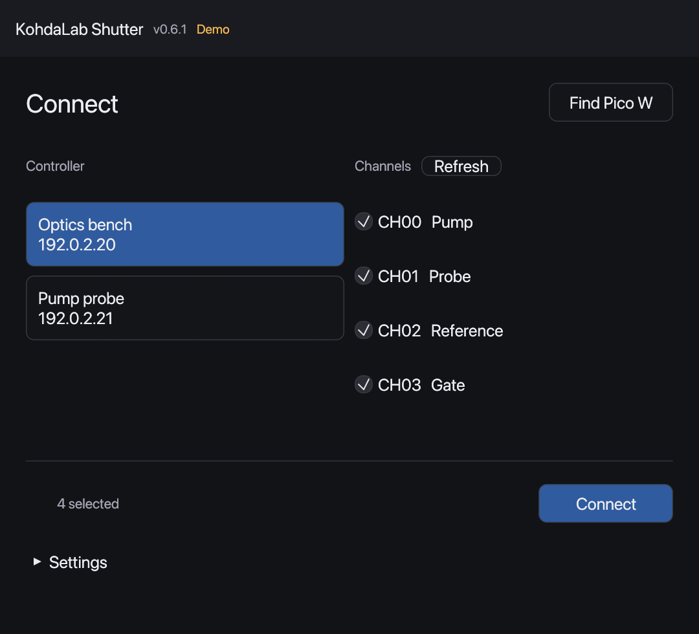
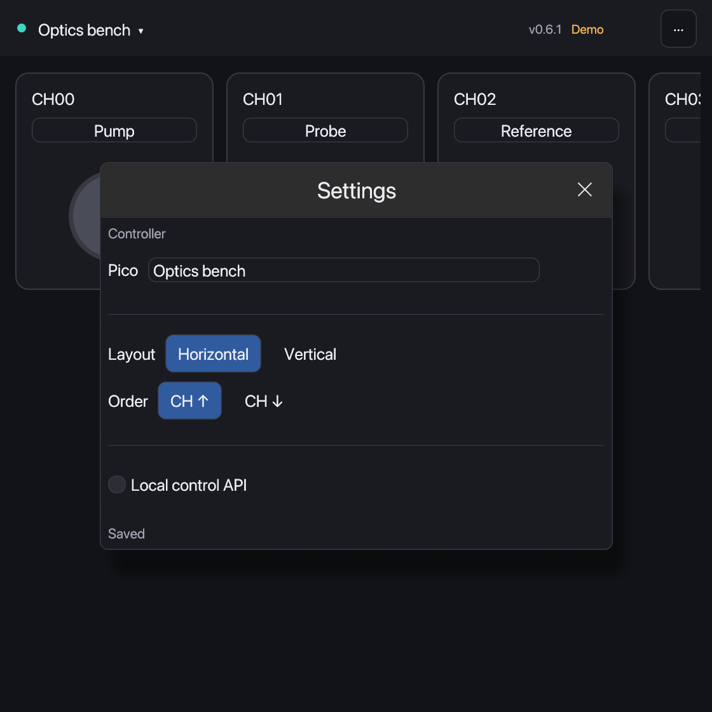

# KohdaLab Shutter

[](https://github.com/woolen-yarn/kohdalab-shutter/actions/workflows/test.yml)
[](LICENSE)

Rust desktop controller and MicroPython Pico W firmware for servo-driven optical shutters.
Rust製デスクトップコントローラーと、サーボ式光シャッター用Pico W MicroPythonファームウェアです。

[Documentation / ドキュメント](docs/README.md) · [Report an issue / 問題を報告](https://github.com/woolen-yarn/kohdalab-shutter/issues)

- Select a labelled Pico W and the channels you need in a separate connection screen.
- Locks selected channels on the Pico; other PCs can use the remaining channels.
- Shows only your channels in a compact dark control window, with editable names and clickable light-window switches.

- 接続画面で名前付きのPico Wと使用CHを選びます。
- Pico側で選択CHだけをロックし、残りのCHは他のPCから使用できます。
- 操作画面は使用CHだけを表示する小型の黒テーマです。

## Interface / 画面


Choose a named controller on the left and channels in the vertical list on the right, then Connect. In the compact control window, each CH number sits above its name box. Click the name to edit and press Enter to apply; Escape or clicking elsewhere discards unconfirmed text. Click the light window to toggle the shutter. The connection-name menu contains Disconnect; ··· opens Settings for the Pico name, layout, order and local API. Confirmed names and settings save automatically. Labels are shared through the Pico. The dark palette follows kohdalab-trkr; images use simulated hardware.

接続画面は左で機器、右の縦並びで使用CHを選び、Connectします。操作画面はCH番号の下に名前の入力欄を置き、クリックで編集・Enterで確定します。Escapeや欄外のクリックでは未確定の編集を戻します。光の窓を押すと開閉を切り替えます。上部の接続名メニューにDisconnect、「···」のSettingsにPico名・配置・並び順・外部APIをまとめました。確定した名前と設定は自動保存し、名前はPicoを通じて他のPCにも共有します。黒テーマはkohdalab-trkrと統一しています。画像は模擬接続です。



**Pico firmware update required:** upload the updated `main.py` and new `sessions.py` when upgrading from firmware older than v0.6.0. v0.6.1 only changes the desktop GUI; a Pico already running v0.6.0 needs no update. Keep your calibrated `settings.py`, `wifi_config.py` and `device_config.json`. Connected CH LEDs double-flash; after a lost connection, leases expire in 15 seconds without moving the shutter. [Update instructions](docs/install.md#pico-firmware-update--pico側の更新)

**v0.6.0より前のPicoには更新が必要です。** v0.6.0導入済みなら、v0.6.1でPicoを再更新する必要はありません。 `main.py`と新しい`sessions.py`を転送してください。校正済みの`settings.py`・Wi-Fi設定・保存済みラベルは保持します。接続CHのLEDは二連点滅し、通信断の15秒後にロックだけを解放します。

<details>
<summary>Vertical layout / 縦並び</summary>


</details>

<details>
<summary>Descending order / 降順</summary>


Ordering changes the display only; hardware channel identifiers stay fixed.

表示順だけが変わり、実機のCH番号は変わりません。

</details>

## Downloads / ダウンロード

Download the desktop app from [GitHub Releases](https://github.com/woolen-yarn/kohdalab-shutter/releases/latest). No Rust or Python installation is needed to run the GUI.

[GitHub Releases](https://github.com/woolen-yarn/kohdalab-shutter/releases/latest)から配布アプリをダウンロードできます。PCでGUIを使うためにRust・Pythonは不要です。

| Platform / OS | Download / ファイル |
| --- | --- |
| Windows 10/11 (x64) | `kohdalab-shutter-0.6.0-windows-x64-Setup.exe` — install and open from Start / インストール後、スタートメニューから起動 |
| macOS 13+ (Apple Silicon / Intel) | `kohdalab-shutter-0.6.0-macos-universal.dmg` — drag the app to Applications / アプリをApplicationsへドラッグ |

The first release is not publisher-signed or Apple-notarized; see the [installation guide / 導入手順](docs/install.md) for first-launch prompts. Pico W firmware upload still requires separate MicroPython tools.

今回の配布物は発行元の署名・Appleの公証がないため、初回起動で確認が出ることがあります。[導入手順](docs/install.md)をご覧ください。Pico Wへの初回転送には別途MicroPython用ツールが必要です。

## Code signing / 署名・公証

The published v0.6.0 files retain their current unsigned/ad-hoc status. Windows follows the same SignPath Foundation preparation/approval policy as TRKR/IV, with an exact two-executable scope. A protected manual Developer ID/notarization workflow is prepared for Mac and requires owner enrollment/certificate setup before activation. See [signing setup](docs/code-signing.md), [policy](CODE_SIGNING_POLICY.md) and [privacy](PRIVACY.md).

公開中のv0.6.0の署名状態は変わりません。WindowsはTRKR・IVと同じSignPath申請準備・承認方針に統一し、Macは登録後に使用するDeveloper ID署名・公証ワークフローを用意しています。まだ本番の署名・公証は実行していません。[設定手順](docs/code-signing.md)を参照してください。

## Automatic settings / 設定の自動保存

Pico/channel names are shared and retained on the Pico in `device_config.json`. Only the owning GUI may rename a channel. After a short typing pause, valid changes save automatically; Settings shows Saving / Saved or an error without disconnecting the shutters. Calibration and Wi-Fi are kept separately.

PC layout, order, selected channels, endpoint/broadcast and Local control API opt-in are retained in `~/.kohdalab/shutter/config.json` (Windows: `%USERPROFILE%\.kohdalab\shutter\config.json`). Authentication tokens are regenerated, not saved. Startup remembers the last device/available CHs but does not acquire channels or move shutters automatically. Corrupt, foreign or unsupported PC configuration files are not overwritten; no old files are migrated or deleted.

Pico名・CH名はPico側に保存し、他のPCとも共有します。PC側の配置・昇降順・選択CH・接続設定・APIの有効無効も保存します。次回起動時に復元しますが、勝手に接続・駆動しません。API認証情報は保存せず、破損設定や他アプリの設定は上書きしません。



## Parallel motion / 並列動作

The updated Pico firmware defaults to moving all configured channels concurrently. Existing devices must also update `SERVO_MAX_ACTIVE` in their own `settings.py` (for example `4` for four channels) and restart; a desktop update alone cannot change the device's current concurrency limit. Preserve your calibrated angles, pins and network settings.

Pico W側も同時駆動数の更新が必要です。実機の既存`settings.py`で`SERVO_MAX_ACTIVE`をCH数（4台なら`4`）に変更し、再起動してください。校正角度・ピン・Wi-Fi/IP設定はそのまま保持します。配布ソースでは`CHANNELS`定義後に`SERVO_MAX_ACTIVE = len(CHANNELS)`としています。

## Supported hardware / 対応ハードウェア

| Role / 役割 | Current implementation / 現在の実装 |
| --- | --- |
| Controller / 制御器 | Raspberry Pi Pico W running MicroPython / MicroPythonを実行するRaspberry Pi Pico W |
| Servo PWM / サーボPWM | PCA9685, one board, up to 16 outputs / PCA9685 1枚、最大16出力 |
| Desktop / PC | Rust GUI and CLI on Windows, macOS, or Linux / Windows・macOS・Linux向けRust GUI・CLI |

## Quick start / はじめに

Explore the interface without connecting hardware / 実機に接続せず画面を試す:

```sh
cargo run --locked --bin kohdalab-shutter-gui -- --demo
```

1. Download and open the app from [Releases](https://github.com/woolen-yarn/kohdalab-shutter/releases/latest), or build from source. / Releasesからアプリを取得するか、ソースからビルドします。
2. Prepare `server/wifi_config.py`, connect the Pico W by USB, and upload the server once. / Wi-Fi設定を用意し、Pico WをUSB接続してサーバーを一度転送します。
3. Start the Pico W server by holding a channel switch for three seconds, unless `AUTO_START_SERVER` is enabled. / `AUTO_START_SERVER`が無効なら、チャンネルスイッチを3秒長押ししてサーバーを開始します。
4. Open KohdaLab Shutter, choose **Find Pico W**, select the intended device, then connect. / GUIを起動し、**Find Pico W**から対象機器を選んで接続します。

The first firmware upload and DHCP/fixed-IP choice are described in [Pico W setup and discovery / Pico Wの設定と検索](docs/rust-client.md). Discovery requires that the PC and Pico W can exchange local UDP traffic; use the USB fallback if the laboratory network blocks it.

初回転送とDHCP・固定IPの選択は[Pico Wの設定と検索](docs/rust-client.md)を参照してください。検索にはPCとPico WのローカルUDP通信が必要です。研究室ネットワークで遮断される場合はUSB確認を使用します。

## External control / 外部制御

Python/Jupyter can attach to the running GUI using an opt-in local API. The GUI owns the Pico connection, and GUI/API actions share the same serialized path and calibrated Open/Close states.

Python/Jupyterから起動中GUIへ接続できます。Pico接続はGUIが所有し、手動操作とAPI操作は同じ制御経路・Open/Close判定を使います。

```sh
cargo run --release --locked --bin kohdalab-shutter-gui -- --demo --gui-api
python -m pip install ./bindings/python
```

See the [Python client guide](bindings/python/README.md) and [GUI API reference](docs/gui-api.md). Open/Close display requires the updated Pico firmware; older firmware remains controllable and displays Unknown.

詳しくは[Pythonクライアント](bindings/python/README.md)と[GUI API仕様](docs/gui-api.md)を参照してください。Open/Close表示にはPico側も更新します。旧ファームウェアでは操作は可能ですが、状態はUnknownと表示します。

## Development / 開発

```sh
cargo fmt --check
cargo clippy --locked --all-targets -- -D warnings
cargo test --locked --all-targets
uv run ruff check .
uv run mypy
uv run pytest --cov --cov-report=term-missing
```

Tests do not move a shutter or connect hardware. See [Contributing](CONTRIBUTING.md) and [Safety notes](SAFETY.md) before a physical test.

テストはシャッターを動かさず、実機にも接続しません。実機試験の前に[開発ガイド](CONTRIBUTING.md)と[安全上の注意](SAFETY.md)を確認してください。

## Related projects / 関連プロジェクト

- [KohdaLab IV](https://github.com/woolen-yarn/kohdalab-iv): DC I-V / V-I measurement desktop application.
- [KohdaLab TRKR](https://github.com/woolen-yarn/kohdalab-trkr): time-resolved Kerr rotation measurement desktop application.

## License / ライセンス

MIT. See [LICENSE](LICENSE).
