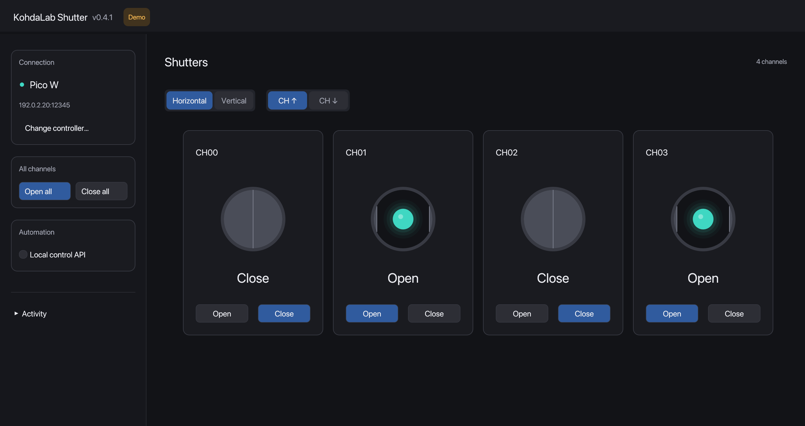
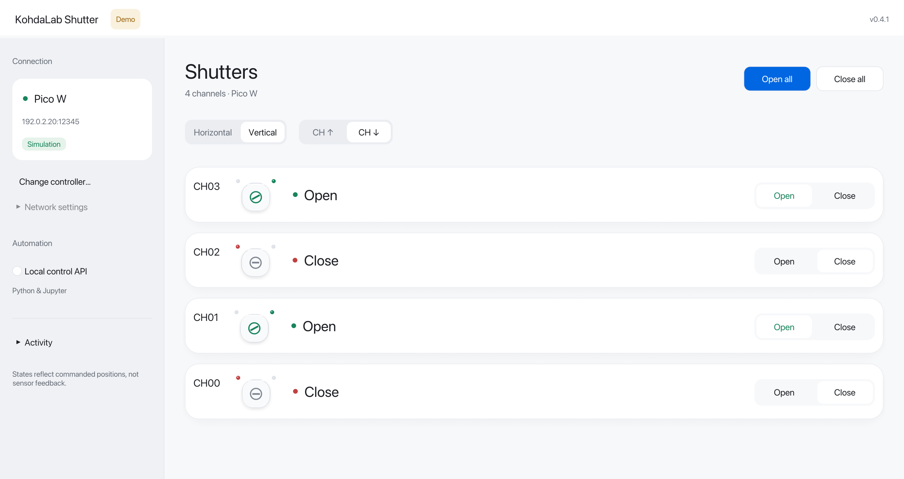
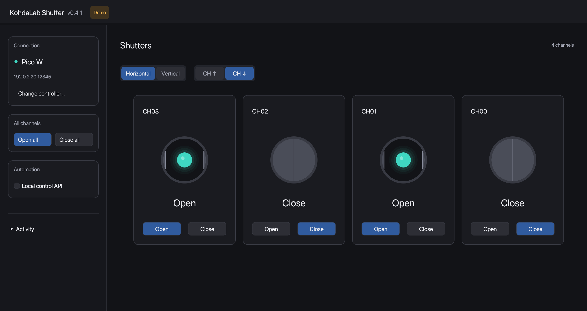

# KohdaLab Shutter

[](https://github.com/woolen-yarn/kohdalab-shutter/actions/workflows/test.yml)
[](LICENSE)

Rust desktop controller and MicroPython Pico W firmware for servo-driven optical shutters.
Rust製デスクトップコントローラーと、サーボ式光シャッター用Pico W MicroPythonファームウェアです。

[Documentation / ドキュメント](docs/README.md) · [Report an issue / 問題を報告](https://github.com/woolen-yarn/kohdalab-shutter/issues)

- Discovers running Pico W shutter servers on the local network and requires an explicit device selection.
- Controls any reported channel count with per-channel and all-channel Open / Close actions.
- Keeps servo control on the Pico W: stepped motion, one-at-a-time scheduling, and PWM release after settling.

- 稼働中のPico Wをローカルネットワーク内で検索し、対象機器を明示的に選択します。
- STATUS応答に含まれるチャンネル数に応じて、個別・一括の開閉操作を表示します。
- サーボ制御はPico W上で実行し、段階駆動・同時駆動制限・停止後のPWM解放を行います。

## Interface / 画面



The left panel finds and connects a Pico W, the centre shows light-window graphics and Open / Close controls in a horizontal row. Choose Horizontal or Vertical to change the layout, and CH ↑ / CH ↓ to change the channel display order; all-channel actions, connection details and activity stay in the left panel. The dark palette and blue controls follow kohdalab-trkr, with the version beside the app title. The image is simulated; no shutter hardware is connected.

左でPico Wを検索・接続し、中央の丸い窓で開閉状態を確認し、その下のOpen／Closeで操作します。kohdalab-trkrと共通の黒テーマ・青いボタンを使用し、上部にバージョンを表示します。Horizontal／Verticalで配置、CH ↑／CH ↓で昇順・降順を切り替え、一括開閉・接続情報・履歴は左パネルに集約しています。画像はシミュレーションであり、実機は接続していません。

<details>
<summary>Vertical layout / 縦並び</summary>



</details>

<details>
<summary>Descending order / 降順</summary>



Ordering changes the display only; hardware channel identifiers stay fixed.

表示順だけが変わり、実機のCH番号は変わりません。

</details>

## Downloads / ダウンロード

Download the desktop app from [GitHub Releases](https://github.com/woolen-yarn/kohdalab-shutter/releases/latest). No Rust or Python installation is needed to run the GUI.

[GitHub Releases](https://github.com/woolen-yarn/kohdalab-shutter/releases/latest)から配布アプリをダウンロードできます。PCでGUIを使うためにRust・Pythonは不要です。

| Platform / OS | Download / ファイル |
| --- | --- |
| Windows 10/11 (x64) | `kohdalab-shutter-0.4.1-windows-x64.zip` — extract and open `kohdalab-shutter-gui.exe` / 展開してexeを起動 |
| macOS 13+ (Apple Silicon / Intel) | `kohdalab-shutter-0.4.1-macos-universal.dmg` — drag the app to Applications / アプリをApplicationsへドラッグ |

The first release is not publisher-signed or Apple-notarized; see the [installation guide / 導入手順](docs/install.md) for first-launch prompts. Pico W firmware upload still requires separate MicroPython tools.

今回の配布物は発行元の署名・Appleの公証がないため、初回起動で確認が出ることがあります。[導入手順](docs/install.md)をご覧ください。Pico Wへの初回転送には別途MicroPython用ツールが必要です。

## Code signing / 署名・公証

The published v0.4.1 files retain their current unsigned/ad-hoc status. Windows follows the same SignPath Foundation preparation/approval policy as TRKR/IV, with an exact two-executable scope. A protected manual Developer ID/notarization workflow is prepared for Mac and requires owner enrollment/certificate setup before activation. See [signing setup](docs/code-signing.md), [policy](CODE_SIGNING_POLICY.md) and [privacy](PRIVACY.md).

公開中のv0.4.1の署名状態は変わりません。WindowsはTRKR・IVと同じSignPath申請準備・承認方針に統一し、Macは登録後に使用するDeveloper ID署名・公証ワークフローを用意しています。まだ本番の署名・公証は実行していません。[設定手順](docs/code-signing.md)を参照してください。

## Supported hardware / 対応ハードウェア

| Role / 役割 | Current implementation / 現在の実装 |
| --- | --- |
| Controller / 制御器 | Raspberry Pi Pico W running MicroPython / MicroPythonを実行するRaspberry Pi Pico W |
| Servo PWM / サーボPWM | PCA9685, one board, up to 16 outputs / PCA9685 1枚、最大16出力 |
| Desktop / PC | Rust GUI and CLI on Windows, macOS, or Linux / Windows・macOS・Linux向けRust GUI・CLI |

## Quick start / はじめに

Explore the interface without connecting hardware / 実機に接続せず画面を試す:

```sh
cargo run --locked --bin kohdalab-shutter-gui -- --demo
```

1. Download and open the app from [Releases](https://github.com/woolen-yarn/kohdalab-shutter/releases/latest), or build from source. / Releasesからアプリを取得するか、ソースからビルドします。
2. Prepare `server/wifi_config.py`, connect the Pico W by USB, and upload the server once. / Wi-Fi設定を用意し、Pico WをUSB接続してサーバーを一度転送します。
3. Start the Pico W server by holding a channel switch for three seconds, unless `AUTO_START_SERVER` is enabled. / `AUTO_START_SERVER`が無効なら、チャンネルスイッチを3秒長押ししてサーバーを開始します。
4. Open KohdaLab Shutter, choose **Find Pico W**, select the intended device, then connect. / GUIを起動し、**Find Pico W**から対象機器を選んで接続します。

The first firmware upload and DHCP/fixed-IP choice are described in [Pico W setup and discovery / Pico Wの設定と検索](docs/rust-client.md). Discovery requires that the PC and Pico W can exchange local UDP traffic; use the USB fallback if the laboratory network blocks it.

初回転送とDHCP・固定IPの選択は[Pico Wの設定と検索](docs/rust-client.md)を参照してください。検索にはPCとPico WのローカルUDP通信が必要です。研究室ネットワークで遮断される場合はUSB確認を使用します。

## External control / 外部制御

Python/Jupyter can attach to the running GUI using an opt-in local API. The GUI owns the Pico connection, and GUI/API actions share the same serialized path and calibrated Open/Close states.

Python/Jupyterから起動中GUIへ接続できます。Pico接続はGUIが所有し、手動操作とAPI操作は同じ制御経路・Open/Close判定を使います。

```sh
cargo run --release --locked --bin kohdalab-shutter-gui -- --demo --gui-api
python -m pip install ./bindings/python
```

See the [Python client guide](bindings/python/README.md) and [GUI API reference](docs/gui-api.md). Open/Close display requires the updated Pico firmware; older firmware remains controllable and displays Unknown.

詳しくは[Pythonクライアント](bindings/python/README.md)と[GUI API仕様](docs/gui-api.md)を参照してください。Open/Close表示にはPico側も更新します。旧ファームウェアでは操作は可能ですが、状態はUnknownと表示します。

## Development / 開発

```sh
cargo fmt --check
cargo clippy --locked --all-targets -- -D warnings
cargo test --locked --all-targets
uv run ruff check .
uv run mypy
uv run pytest --cov --cov-report=term-missing
```

Tests do not move a shutter or connect hardware. See [Contributing](CONTRIBUTING.md) and [Safety notes](SAFETY.md) before a physical test.

テストはシャッターを動かさず、実機にも接続しません。実機試験の前に[開発ガイド](CONTRIBUTING.md)と[安全上の注意](SAFETY.md)を確認してください。

## Related projects / 関連プロジェクト

- [KohdaLab IV](https://github.com/woolen-yarn/kohdalab-iv): DC I-V / V-I measurement desktop application.
- [KohdaLab TRKR](https://github.com/woolen-yarn/kohdalab-trkr): time-resolved Kerr rotation measurement desktop application.

## License / ライセンス

MIT. See [LICENSE](LICENSE).
