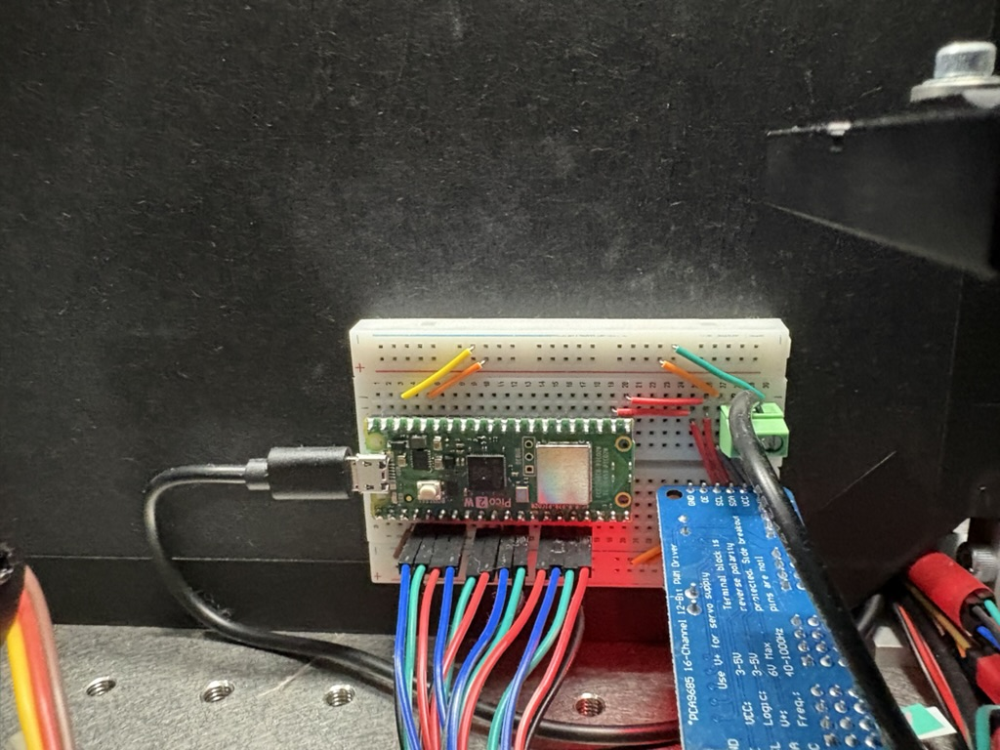
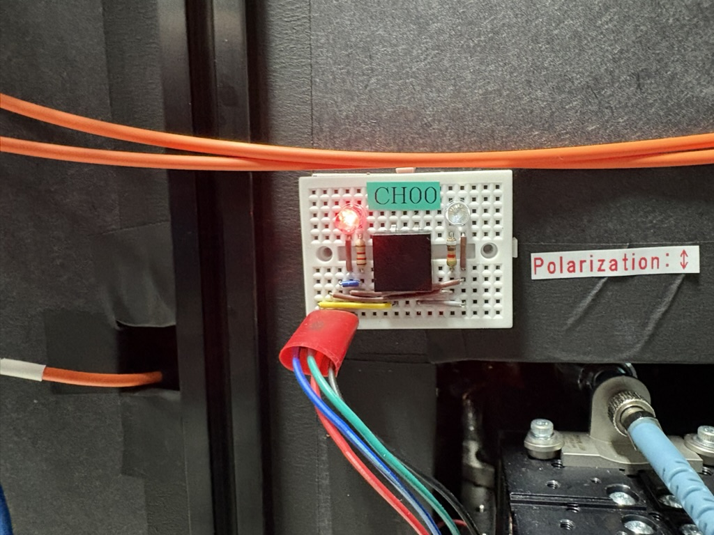
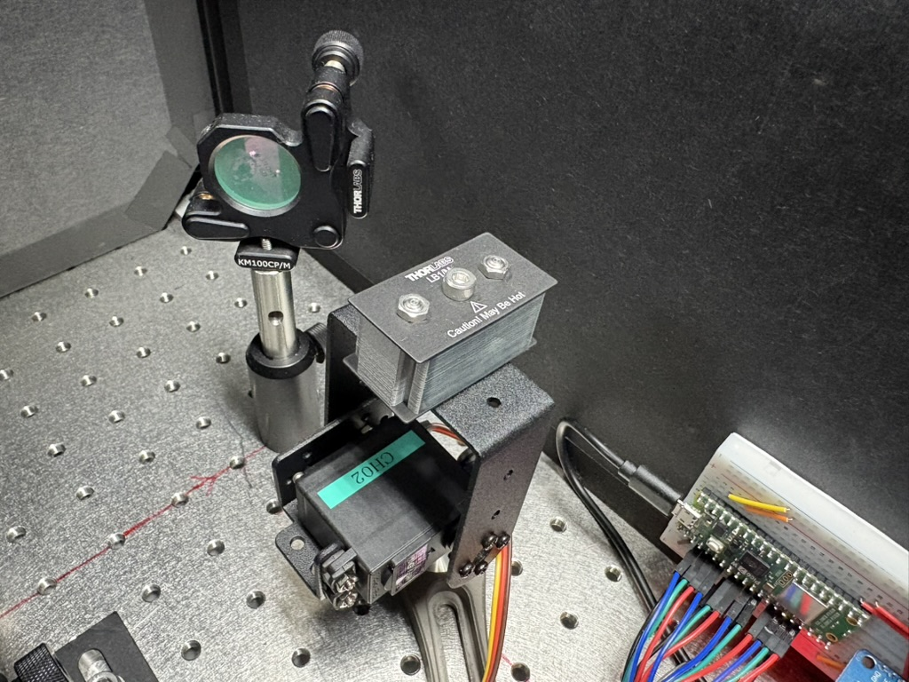

# KohdaLab Shutter Controller Usage Guide

This guide keeps the detailed operating notes for KohdaLab Shutter Controller. For first-time machine setup, see [Initial setup](initial_setup.md).

## Overview / 概要

**JP:** Raspberry Pi Pico W と PCA9685 を使って、サーボ式シャッターを Wi-Fi 経由で操作する装置です。現在の標準構成は 4CH ですが、チャンネル定義を増やすことで nCH 構成へ拡張しやすいように整理しています。

**EN:** This project controls servo-driven optical shutters over Wi-Fi using a Raspberry Pi Pico W and a PCA9685 PWM driver. The default build is a 4-channel system, but the code is organized so it can be expanded to an n-channel setup by adding channel definitions.

## Directory Structure / ディレクトリ構成

```text
.
├── server/              # MicroPython code copied to the Pico W / Pico Wへ転送するコード
│   ├── main.py          # Buttons, LEDs, Wi-Fi server, servo control
│   ├── pca9685.py       # PCA9685 PWM driver
│   ├── settings.py      # Pin mapping, IP, port, channel definitions
│   ├── wifi_config.py   # Local Wi-Fi credentials, do not share
│   └── wifi_config.example.py
├── client/              # PC-side client tools / PC側クライアント
│   ├── cli.py           # Command-line interface
│   ├── gui.py           # PySide6 / Qt GUI
│   ├── protocol.py      # TCP text protocol helpers
│   └── transport.py     # TCP communication
├── docs/
│   ├── specification.md # Detailed bilingual specification / 詳細仕様書
│   ├── purchase-list.md # Purchase list / 購入品リスト
│   └── images/          # Device photos / 装置写真
├── pyproject.toml
└── uv.lock
```

## Device Photos / 装置写真

**JP:** Pico W、PCA9685、電源まわりの制御基板です。
**EN:** Pico W, PCA9685, and the controller-side wiring.



**JP:** CH00 のスイッチ・LED 小基板です。赤 LED、緑 LED、押しボタン、チャンネル表示が載っています。
**EN:** The CH00 switch/LED board with red LED, green LED, push button, and channel label.



**JP:** サーボでシャッター機構を動かしている例です。
**EN:** Example of the physical shutter mechanism driven by a servo.



## Current Pin Mapping / 現在のピン割り当て

**JP:** 設定は [server/settings.py](../server/settings.py) に集約しています。

**EN:** All hardware settings are collected in [server/settings.py](../server/settings.py).

| Channel | PCA9685 | Switch GPIO | Green LED GPIO | Red LED GPIO | Close | Open |
| --- | ---: | ---: | ---: | ---: | ---: | ---: |
| CH00 | 0 | 2 | 3 | 4 | 0 deg | 90 deg |
| CH01 | 1 | 5 | 6 | 7 | 0 deg | 90 deg |
| CH02 | 2 | 8 | 9 | 10 | 0 deg | 90 deg |
| CH03 | 3 | 11 | 12 | 13 | 0 deg | 90 deg |

**JP:** I2C は `SDA=GPIO16`, `SCL=GPIO17`、PCA9685 の I2C アドレスは `0x40` です。Pico W 側の固定 IP は `10.32.145.232`、TCP ポートは `12345` です。

**EN:** I2C uses `SDA=GPIO16` and `SCL=GPIO17`. The PCA9685 I2C address is `0x40`. The Pico W uses the static IP `10.32.145.232` and TCP port `12345`.

## Wi-Fi Credentials / Wi-Fi 情報の扱い

**JP:** SSID とパスワードは `server/wifi_config.py` に置きます。このファイルは `.gitignore` 対象で、共有しない前提です。公開・配布するときは [server/wifi_config.example.py](../server/wifi_config.example.py) だけを共有し、各環境で `wifi_config.py` を作成してください。

**EN:** Store the SSID and password in `server/wifi_config.py`. This file is ignored by Git and should not be shared. When publishing or sharing the project, include only [server/wifi_config.example.py](../server/wifi_config.example.py), and let each user create their own `wifi_config.py`.

```python
SSID = "your-ssid"
PASSWORD = "your-password"
```

## PC Setup / PC 側セットアップ

**JP:** このプロジェクトでは `uv` を使います。仮想環境を手動で activate しなくても、`uv run` で実行できます。

**EN:** This project uses `uv`. You do not need to manually activate the virtual environment; use `uv run` to execute commands.

```powershell
uv sync
```

GUI:

```powershell
uv run python -m client.gui
```

**JP:** GUI は PySide6 / Qt で実装しています。基本テーマは暗室や実験室で見やすいダークテーマです。接続状態、最終更新時刻、チャンネル数、全体 OPEN/CLOSE、チャンネル別 OPEN/CLOSE/TOGGLE を表示します。チャンネル数が増えた場合は `STATUS` 応答に合わせて一覧が自動生成されます。

**EN:** The GUI is implemented with PySide6 / Qt. The default theme is a dark theme intended to be readable in dark rooms and lab environments. It shows connection status, last update time, channel count, global OPEN/CLOSE controls, and per-channel OPEN/CLOSE/TOGGLE controls. If the channel count changes, the channel list is generated from the `STATUS` response.

CLI:

```powershell
uv run python -m client.cli status
uv run python -m client.cli open 0
uv run python -m client.cli close 0
uv run python -m client.cli toggle 0
```

With explicit IP / IP を明示する場合:

```powershell
uv run python -m client.cli --host 10.32.145.232 status
```

Legacy-style positional IP / 先頭に IP を書く形式:

```powershell
uv run python -m client.cli 10.32.145.232 status
```

## Upload to Pico W / Pico W への転送

**JP:** Pico W を USB 接続し、MicroPython を書き込んだ状態で実行します。
**EN:** Connect the Pico W over USB and make sure MicroPython is already installed.

```powershell
uv run mpremote connect auto fs cp server/main.py :main.py
uv run mpremote connect auto fs cp server/pca9685.py :pca9685.py
uv run mpremote connect auto fs cp server/settings.py :settings.py
uv run mpremote connect auto fs cp server/wifi_config.py :wifi_config.py
uv run mpremote connect auto reset
```

**JP:** 起動直後は `AUTO_START_SERVER = False` なので、任意のチャンネルボタンを 3 秒以上長押しすると Wi-Fi サーバが開始します。起動時からサーバを開始したい場合は [server/settings.py](../server/settings.py) の `AUTO_START_SERVER` を `True` にします。

**EN:** By default, `AUTO_START_SERVER = False`, so the Wi-Fi server starts when any channel button is held for at least 3 seconds. To start the server automatically at boot, set `AUTO_START_SERVER = True` in [server/settings.py](../server/settings.py).

## Build Procedure / 作り方

1. **JP:** Pico W をブレッドボードへ載せ、USB で給電・書き込みできるようにします。
   **EN:** Place the Pico W on a breadboard and connect it by USB for power and programming.
2. **JP:** PCA9685 を Pico W の I2C へ接続します。現在の設定では `SDA=GPIO16`, `SCL=GPIO17` です。
   **EN:** Connect the PCA9685 to the Pico W I2C bus. The current setting uses `SDA=GPIO16` and `SCL=GPIO17`.
3. **JP:** サーボの信号線を PCA9685 の各チャンネルへ接続します。現在は CH00 から CH03 を PCA9685 の 0 から 3 へ接続します。
   **EN:** Connect each servo signal line to a PCA9685 output. The default 4-channel build uses PCA9685 channels 0 through 3.
4. **JP:** 各チャンネルの小基板に、押しボタン、赤 LED、緑 LED を配線します。
   **EN:** Wire the push button, red LED, and green LED for each channel board.
5. **JP:** サーボ電源と Pico/PCA9685 の GND を共通にします。サーボ電源は USB から無理に取らず、必要な電流を供給できる外部電源を使います。
   **EN:** Share ground between the servo power supply, Pico, and PCA9685. Use an external supply capable of providing enough servo current instead of relying on USB power.
6. **JP:** `server/wifi_config.py` に Wi-Fi 情報を入れ、Pico へサーバ側ファイルを転送します。
   **EN:** Fill in `server/wifi_config.py` and upload the server files to the Pico.
7. **JP:** ボタン長押しでサーバを起動し、PC 側 GUI または CLI から接続確認します。
   **EN:** Start the server by holding a button, then test the connection from the PC GUI or CLI.

## Expanding to n Channels / nCH 化

**JP:** 基本方針は [server/settings.py](../server/settings.py) の `CHANNELS` を増やすことです。PC 側クライアントは `STATUS` 応答に含まれるチャンネル数を見て動くため、通常は変更不要です。

**EN:** To expand the system, add entries to `CHANNELS` in [server/settings.py](../server/settings.py). The PC clients read the channel list from the `STATUS` response, so they usually do not need code changes.

```python
CHANNELS = (
    {"label": "CH00", "servo": 0, "switch": 2, "green": 3, "red": 4, "close": 0, "open": 90},
    {"label": "CH01", "servo": 1, "switch": 5, "green": 6, "red": 7, "close": 0, "open": 90},
    # Add CH04, CH05, ... here.
)
```

**JP:** PCA9685 1 枚で扱えるサーボは 16CH までです。ボタンと LED に使える Pico GPIO にも限りがあるため、さらに増やす場合は PCA9685 の追加、I/O エキスパンダ、LED ドライバなどを検討してください。

**EN:** One PCA9685 board supports up to 16 servo outputs. Pico GPIO pins are also limited because each channel uses a button plus two LEDs. For larger builds, consider adding another PCA9685, using an I/O expander, or using a dedicated LED driver.

See [specification.md](specification.md) for the detailed protocol and expansion rules.

詳しい通信仕様と拡張ルールは [specification.md](specification.md) を参照してください。

See [purchase-list.md](purchase-list.md) for the purchase list.

購入品リストは [purchase-list.md](purchase-list.md) を参照してください。

## Safety / 安全

Read [SAFETY.md](../SAFETY.md) before operating real shutters. Always confirm
power, wiring, servo angles, optical path safety, and a manual way to block or
disable the optical path.

実機を操作する前に [SAFETY.md](../SAFETY.md) を確認してください。電源、配線、
サーボ角度、光路の安全性、手動で光路を遮断または無効化する方法を必ず確認してください。

## Windows Setup / Windows セットアップ

Use [windows_setup.md](windows_setup.md) when preparing a Windows PC.

Windows PC の準備には [windows_setup.md](windows_setup.md) を使ってください。

## Citation / 引用

If you use this software in research, see [CITATION.cff](../CITATION.cff).

研究でこのソフトウェアを使う場合は [CITATION.cff](../CITATION.cff) を参照してください。

## License / ライセンス

This project is released under the MIT License. See [LICENSE](../LICENSE).

このプロジェクトは MIT License で公開されています。詳細は [LICENSE](../LICENSE) を参照してください。
